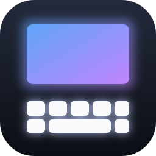
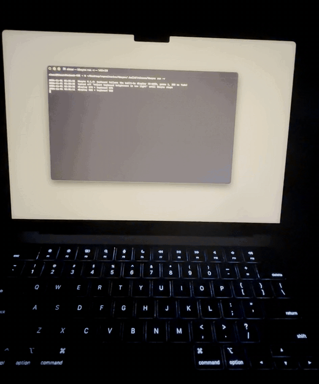
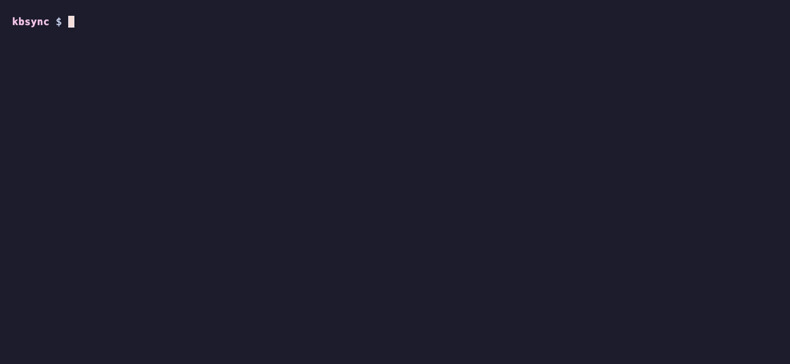
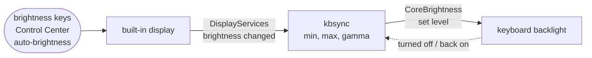

<div align="center">



# kbsync

**Makes your MacBook's keyboard backlight follow your screen brightness.**

[](#faq)
[](#faq)
[](Package.swift)
[](Package.swift)
[](LICENSE)

<a href="#quick-start">⚡️ Quick start</a> • <a href="#usage">⚙️ Usage</a> • <a href="#battery">🔋 Battery</a> • <a href="#how-it-works">🔬 How it works</a> • <a href="#faq">❓ FAQ</a>

<br>



</div>

## ✨ What it does

- Dims and brightens the keyboard with the screen, however you change it: brightness keys, Control Center, auto-brightness or another app.
- Reacts in about 7 ms.
- Uses no CPU while idle and about 4.6 MB of memory.
- Leaves the keyboard off when macOS turns it off after inactivity.
- Lets you set the keyboard's lowest and highest level.
- Runs in the background and starts at login.

<a name="quick-start"></a>
## ⚡️ Quick start

You need a MacBook with a backlit keyboard, macOS 14 or later, and Xcode or the Command Line Tools.

```bash
git clone https://github.com/simar-s2/kbsync && cd kbsync
make build
.build/release/kbsync run -v     # try it; Ctrl-C to stop

sudo make install                # copy to /usr/local/bin
kbsync install                   # run in the background and at login
```

<p align="center">
  
</p>

<a name="usage"></a>
## ⚙️ Usage

| Command | What it does |
|---|---|
| `kbsync run` | Follow the screen until you press Ctrl-C |
| `kbsync install` | Run in the background and at login |
| `kbsync uninstall` | Stop it and remove it from login |
| `kbsync status` | Show both brightness levels and whether it's running |

| Option | Default | What it does |
|---|---|---|
| `--min <0-100>` | `0` | Keyboard level when the screen is at its dimmest |
| `--max <0-100>` | `100` | Keyboard level when the screen is at its brightest |
| `--gamma <x>` | `1` | Curve shape; above 1 keeps the keyboard dimmer in the middle |
| `--fade <ms>` | `250` | How long each change fades for |
| `--keep-auto` | off | Leave "Adjust keyboard brightness in low light" on |
| `-v` | off | Print every change |

The keyboard level is `min + (max − min) × screen^gamma`. For example, `kbsync install --max 60` keeps the keyboard at 60% or below.

<a name="battery"></a>
## 🔋 Battery and memory

Measured on a MacBook Pro (M1 Pro, macOS 26.6):

| Measure | Result |
|---|---|
| Idle | 0 wakeups, 0.0% CPU |
| Memory | About 4.6 MB. Unchanged after 20,000 brightness changes, and 0 leaks |
| Each change | About 0.1 ms of CPU |
| Delay | About 7 ms |

kbsync doesn't poll. It only wakes up when macOS reports a brightness change.

<a name="how-it-works"></a>
## 🔬 How it works



macOS has no public API for either brightness, so kbsync uses two private frameworks:

- **DisplayServices** tells it when the screen brightness changes.
- **CoreBrightness** sets the keyboard level. It's the same API the Control Center slider uses.

While kbsync runs, it turns off "Adjust keyboard brightness in low light" so the light sensor doesn't fight it. It turns the setting back on when it stops.

More detail, including the bugs I hit along the way: [docs/DESIGN.md](docs/DESIGN.md).

<a name="faq"></a>
## ❓ FAQ

**Will a macOS update break it?** It might, since the APIs are private. If something it needs is missing, kbsync exits and says what.

**Which Macs does it work on?** I've tested it on an M1 Pro running macOS 26.6. Other Apple Silicon MacBooks should work. Intel Macs are untested.

**I changed the brightness and the keyboard didn't move.** macOS had turned the keyboard off because you weren't typing. Press any key and it comes back at the right level.

**Does it follow external monitors?** No, only the built-in screen.

**Can I adjust the keyboard by hand?** Yes, but kbsync resets it on the next screen change. To change where it lands, use `--min`, `--max` or `--gamma`.

## 🛠️ Development

```bash
make test                                       # unit tests
make film                                       # fades the screen down and up, for filming
make gif VIDEO=clip.mov CROP=1080:1300:0:340    # turns a recording into docs/images/hero.gif
```

## 📄 License

[MIT](LICENSE)
