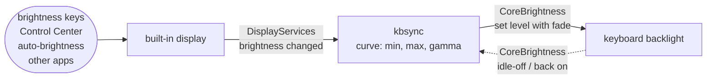

<div align="center">


# kbsync

**Your MacBook's keyboard backlight, in step with your screen.**<br>
Dim the screen and the keyboard dims with it. Brighten it and the keyboard comes back.

[](#faq)
[](#faq)
[](Package.swift)
[](Package.swift)
[](LICENSE)

<a href="#quick-start">⚡️ Quick start</a> • <a href="#options">⚙️ Options</a> • <a href="#battery">🔋 Battery and memory</a> • <a href="#how-it-works">🔬 How it works</a> • <a href="#faq">❓ FAQ</a>

</div>

<br>

<p align="center">
  
  <br>
  <sub>Filmed on my MacBook Pro: screen and keyboard dim together, go dark together, and come back together.</sub>
</p>

macOS can dim the keyboard for a dark room, or switch it off when you stop typing, but nothing ties it to the screen. Turn the screen down at night and the keyboard stays as bright as it was, so you go into Control Center and fix it by hand. I looked for a tool that does this and found ones that cap the backlight, dim it below the minimum, or light it only while you type, but none that follow the display. So I built kbsync: a small background tool that moves the keyboard backlight whenever the screen brightness changes, however you change it.

## ✨ Features

| Feature | What it means |
|---|---|
| 🌗 **Follows the screen** | Brightness keys, Control Center, auto-brightness, other apps: any change to the built-in display moves the keyboard to match, with a short fade. |
| ⚡️ **Instant** | The keyboard follows in about 7 ms. kbsync reacts to the system's brightness notification instead of checking on a timer. |
| 🔋 **Costs nothing when idle** | 0 wakeups and 0.0% CPU between changes, with about 4.6 MB of memory. [Measurements](#battery). |
| 💤 **Respects idle-off** | When macOS switches the backlight off because you stopped typing, kbsync leaves it off and catches up the moment you're back. |
| 🎛️ **Tunable** | `--min`, `--max` and `--gamma` change how the screen level maps to the keyboard level. |
| 🚀 **Starts at login** | One command sets it up as a launch agent: `kbsync install`. |
| 🪶 **No dependencies** | A single Swift binary. Nothing to keep updated. |

<a name="quick-start"></a>
## ⚡️ Quick start

You need a MacBook with a backlit keyboard, macOS 14 or later, and Xcode or the Command Line Tools (`xcode-select --install`).

```bash
git clone https://github.com/simar-s2/kbsync && cd kbsync
make build
.build/release/kbsync run -v       # try it: press the brightness keys and watch the keyboard
```

With `-v` it logs every change. In this recording the display is swept automatically; halfway through, macOS's 30-second idle timeout switches the backlight off, and kbsync sets 55% the moment the keyboard wakes.

<p align="center">
  
</p>

Happy with it? Install it and have it start at every login:

```bash
sudo make install                  # copies kbsync to /usr/local/bin
kbsync install                     # starts it now and at every login
```

That's it. 🎉 macOS will show a "Background Items Added" notification, and kbsync appears under System Settings → General → Login Items.

```bash
kbsync status                      # both brightness levels, and whether the agent is running
kbsync uninstall                   # stop it and remove it from login
```

<a name="options"></a>
## ⚙️ Options

```
kbsync run [options]       follow the display in the foreground (Ctrl-C to stop)
kbsync status [options]    show both brightness levels and whether the agent is running
kbsync install [options]   run in the background and at login, with these options
kbsync uninstall           stop the background agent and remove it
```

| Option | Default | What it does |
|---|---|---|
| `--min <0-100>` | `0` | Keyboard brightness when the screen is at its dimmest |
| `--max <0-100>` | `100` | Keyboard brightness when the screen is at its brightest |
| `--gamma <x>` | `1` | Curve shape: above 1 keeps the keyboard dimmer through the middle, below 1 brighter |
| `--fade <ms>` | `250` | How long each keyboard change fades for |
| `--keep-auto` | off | Leave "Adjust keyboard brightness in low light" switched on |
| `-v`, `--verbose` | off | Log every change |

The keyboard level is `min + (max − min) × screen^gamma`, with both levels on the 0 to 1 scale of the Control Center sliders. Options given to `kbsync install` are saved into the agent; run it again to change them.

```bash
kbsync install --max 60            # never brighter than 60%
kbsync install --min 10            # keep a little light even with the screen at its dimmest
kbsync install --gamma 2           # stay dim through the middle, brighten near the top
kbsync status --max 60             # see what a curve would give right now, without changing anything
```

<a name="battery"></a>
## 🔋 Battery and memory

kbsync sits in the background all day, so I measured it on a 14-inch MacBook Pro (M1 Pro, macOS 26.6):

| Measure | Result |
|---|---|
| **Idle** | 0 wakeups, 0.0% CPU and 0.0 energy impact over a 30-second sample (`top`). Between brightness changes it does no work at all. |
| **Memory** | About 4.6 MB physical footprint, the number Activity Monitor shows. It stayed flat across 20,000 brightness changes. |
| **Leaks** | `leaks` reported 0 leaked bytes after the stress test. |
| **Under stress** | 10,000 brightness changes in 19 seconds, far more than a normal day, cost 0.9 s of CPU in total, about 0.1 ms per change. |
| **Bursts** | Holding a brightness key or dragging the slider sends hundreds of notifications a second. kbsync merges each burst into a single update, so the work stays bounded. |
| **Speed** | Median 7 ms from a screen change to the keyboard reaching its new level. |

It never polls. macOS wakes kbsync only when the brightness actually changes, and the rest of the time the process is asleep.

<a name="how-it-works"></a>
## 🔬 How it works



Neither the display brightness nor the keyboard backlight has a public API on Apple Silicon. kbsync uses the private frameworks behind the system's own brightness controls, loaded at runtime:

- **DisplayServices** provides the built-in display's brightness and a change notification. The notification is system wide: one process receives it when any other process changes the brightness, so it covers the keys, Control Center and auto-brightness without polling.
- **CoreBrightness** contains `KeyboardBrightnessClient`, the class behind the keyboard slider in Control Center. kbsync checks that every method it needs exists before calling any of them.

On each notification kbsync reads the display level, runs it through the curve, and sets the keyboard if it's more than half a percent off ([`Syncer.swift`](Sources/KBSyncCore/Syncer.swift)). It also re-syncs at startup, when displays are reconfigured (lid closed or opened, monitors plugged in), when the screens wake, and when the keyboard comes back from idle-off.

<details>
<summary><b>Design notes: what I found while probing the private APIs</b></summary>

<br>

- **Why not poll?** To feel instant, polling has to run ten or more times a second, waking the CPU constantly to watch a value that changes a few times an hour. The notification costs nothing until the brightness actually changes.
- **Idle-off.** While macOS holds the backlight off after inactivity, `brightnessForKeyboard:` reports 0, and writes are accepted but don't light the keyboard. I found this by leaving the Mac idle with a probe running. So kbsync skips writes while `isBacklightDimmedOnKeyboard:` is true, listens for the `KeyboardBacklightIdleDimActive` and `KeyboardBacklightSuppressed` notifications, and catches up when they clear. The terminal GIF in Quick start shows this: the 30-second timeout hit mid-recording, and the keyboard got its 55% the moment it woke.
- **Suppressed isn't asleep.** CoreBrightness also reports the backlight as suppressed whenever its level is 0%, and the next write lights it straight back up. kbsync first counted suppressed as asleep too, so after the screen went to 0% the keyboard stayed dark for good. Now only the idle flag holds writes back.
- **The light sensor.** With "Adjust keyboard brightness in low light" on, the sensor moves the keyboard by itself; while probing, I watched it drift from 24.5% to 24.0% with nothing else touching it. Two controllers fighting over one light is worse than either alone, so kbsync turns the sensor off while it runs and back on when it exits. The display's own auto-brightness is untouched, so if you use it, the keyboard still follows the room, through the display.
- **Fade units.** `setBrightness:fadeSpeed:commit:forKeyboard:` isn't documented. Reading the backlight's PWM duty cycle from the IORegistry during a call with `fadeSpeed: 2000` showed an even ramp over 2.0 s, so the unit is milliseconds.
- **Bursts.** The display notification arrives on a background thread. Each one bumps a GCD "data add" source, which merges any number of bumps into one handler call on the main queue. Before that, a 5,000-change burst queued about 2,500 pending callbacks; with it, at most a handful.

</details>

<a name="faq"></a>
## ❓ FAQ

<details>
<summary><b>Will a macOS update break it?</b></summary>
<br>
It might. DisplayServices and CoreBrightness are private, and Apple can change them in any release. kbsync checks for every function and method at startup and exits with an error naming the missing one, rather than misbehaving.
</details>

<details>
<summary><b>Which Macs does it work on?</b></summary>
<br>
I've tested it on a 14-inch MacBook Pro (M1 Pro) running macOS 26.6. Other Apple Silicon MacBooks use the same frameworks and should work. Intel MacBooks are untested.
</details>

<details>
<summary><b>Why did "Adjust keyboard brightness in low light" switch off?</b></summary>
<br>
kbsync turns it off while it runs, because the light sensor would otherwise keep moving the keyboard away from the screen level. It turns the setting back on when kbsync stops (Ctrl-C, <code>kbsync uninstall</code>, logout). Pass <code>--keep-auto</code> to leave it alone. If kbsync is ever killed outright (<code>kill -9</code>), switch it back on in System Settings → Keyboard.
</details>

<details>
<summary><b>I changed the screen brightness and the keyboard didn't move.</b></summary>
<br>
macOS probably had the backlight off for inactivity ("Turn keyboard backlight off after inactivity" in System Settings → Keyboard). kbsync deliberately doesn't wake it; touch the trackpad or a key and the keyboard comes on at the matching level. <code>kbsync status</code> shows "off after inactivity" when that's the case.
</details>

<details>
<summary><b>Does it follow external monitors?</b></summary>
<br>
No, only the built-in display. With the lid closed there's no keyboard to light, so kbsync waits until the built-in display is back.
</details>

<details>
<summary><b>Can I nudge the keyboard by hand?</b></summary>
<br>
Yes, but only until the next screen change, when kbsync puts it back on the curve. If you always want it brighter or dimmer, use <code>--min</code>, <code>--max</code> or <code>--gamma</code>.
</details>

## 🛠️ Development

```bash
make test       # unit tests (Swift Testing); they never touch the real display or keyboard
make demo       # re-record the terminal GIF with vhs
make film       # a hands-free routine for filming: the screen fades to black and back
make gif VIDEO=~/Movies/kbsync.mov START=2 DURATION=10    # turn a recording into docs/images/hero.gif
```

With only the Command Line Tools installed (no Xcode), SwiftPM can't find Swift Testing on its own; the Makefile adds the framework paths when it detects that setup.

```
Sources/KBSyncCore/   curve, argument parsing, sync rules, launch agent plist (no hardware access)
Sources/kbsync/       DisplayServices and CoreBrightness bridges, the run loop, status/install/uninstall
Tests/                Swift Testing suites with a fake display and keyboard
scripts/              display helper, filming routine, video-to-GIF conversion (demo use only)
docs/                 logo, GIF, vhs tape
```

## 📄 License

[MIT](LICENSE)
