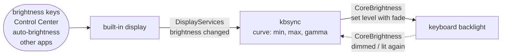

# kbsync

**Keeps a MacBook's keyboard backlight in step with its screen brightness: dim the screen and the keyboard dims with it.**


## Why

macOS has two settings for the keyboard backlight (System Settings → Keyboard): "Adjust keyboard brightness in low light", which follows the ambient light sensor, and "Turn keyboard backlight off after inactivity". Nothing links the keyboard to the screen. Dim the screen at night and the keyboard stays where it was, so you go into Control Center and fix it by hand.

I looked for something that already does this. There are tools that set the backlight from the command line, cap it, dim it below the macOS minimum, or light it only while you type, but none that follow the display. So I wrote one.

## What it does

- **Follows the display:** whenever the built-in display's brightness changes (brightness keys, Control Center, auto-brightness, another app), kbsync sets the keyboard backlight to match, with a short fade.
- **Event driven, not polling:** it subscribes to the system's brightness-change notification. On an M1 Pro the keyboard follows within 7 ms (median of 8 changes, 15 ms worst), and kbsync sits at 0.0% CPU and 15 MB of memory between changes.
- **Respects idle-off:** when macOS has switched the backlight off after inactivity, kbsync doesn't wake it. It applies the latest level as soon as the keyboard lights up again.
- **Takes over from the light sensor while it runs:** with "Adjust keyboard brightness in low light" on, macOS keeps moving the keyboard on its own. kbsync turns that setting off while it runs and back on when it stops.
- **Adjustable curve:** `--min`, `--max` and `--gamma` change how display brightness maps to keyboard brightness.
- **Runs at login:** `kbsync install` sets it up as a launch agent.

**Tech:** Swift with no dependencies. Private macOS frameworks (DisplayServices, CoreBrightness) loaded at runtime through `dlopen` and the Objective-C runtime, launchd, Swift Testing, and charmbracelet/vhs for the recording.

## Quick start

You need a MacBook with a backlit keyboard, macOS 14 or later, and Xcode or the Command Line Tools (`xcode-select --install`).

```bash
git clone https://github.com/simar-s2/kbsync && cd kbsync
make build
.build/release/kbsync status       # current levels and settings
.build/release/kbsync run -v       # follow the display in the foreground, then press the brightness keys
```

To keep it running:

```bash
sudo make install                  # copies kbsync to /usr/local/bin
kbsync install                     # starts it now and at every login
```

macOS shows a "Background Items Added" notification, and kbsync appears under System Settings → General → Login Items. `kbsync install` takes the same options as `run` and saves them into the agent; run it again to change them. `kbsync uninstall` stops and removes the agent, which also turns the light-sensor setting back on. The log is at `~/Library/Logs/kbsync.log`.

## Usage

```
kbsync run [options]       follow the display in the foreground (Ctrl-C to stop)
kbsync status [options]    show both brightness levels and whether the agent is running
kbsync install [options]   run in the background and at login, with these options
kbsync uninstall           stop the background agent and remove it

Options:
  --min <0-100>   keyboard brightness when the display is at its dimmest (default 0)
  --max <0-100>   keyboard brightness when the display is at its brightest (default 100)
  --gamma <x>     curve shape: above 1 keeps the keyboard dimmer mid-range (default 1)
  --fade <ms>     how long each keyboard change fades for (default 250)
  --keep-auto     leave "Adjust keyboard brightness in low light" on
  -v, --verbose   log every change
```

The keyboard level is `min + (max − min) × display^gamma`, with both levels on the 0 to 1 scale the Control Center sliders use. Some examples:

```bash
kbsync install --max 60            # never brighter than 60%
kbsync install --min 10            # keep a little light even with the screen at its dimmest
kbsync install --gamma 2           # stay dim through the middle, brighten near the top
kbsync status --max 60             # see what a curve would give right now, without changing anything
```

## How it works



Neither the display brightness nor the keyboard backlight has a public API on Apple Silicon. kbsync uses the private frameworks behind the system's own brightness controls and loads them at runtime:

- **DisplayServices** provides the built-in display's brightness (`DisplayServicesGetBrightness`) and a change notification (`DisplayServicesRegisterForBrightnessChangeNotifications`). The notification is system wide. I checked that one process receives it when a different process changes the brightness, so it covers the keys, Control Center and auto-brightness without polling.
- **CoreBrightness** contains `KeyboardBrightnessClient`, the class behind the keyboard slider in Control Center. kbsync calls it through an `@objc` protocol after confirming that every selector it needs exists. If a future macOS changes the class, kbsync exits with an error naming what's missing instead of crashing.

On each notification kbsync reads the display level, runs it through the curve, and sets the keyboard if it is more than half a percent off ([`Syncer.swift`](Sources/KBSyncCore/Syncer.swift)). It also re-syncs at startup, when displays are reconfigured (lid closed or opened, monitors plugged in), when the screens wake, and when the keyboard comes back from idle dimming.

## Design notes

- **Why not poll?** To feel instant, polling has to run ten or more times a second, waking the CPU constantly to watch a value that changes a few times an hour. The notification costs nothing until the brightness actually changes.
- **Idle-off.** While macOS holds the backlight off after inactivity, `brightnessForKeyboard:` reports 0, and writes are accepted but don't light the keyboard. I found this by leaving the Mac idle with a probe running. So kbsync skips writes while `isBacklightDimmedOnKeyboard:` is true, listens for the `KeyboardBacklightIdleDimActive` and `KeyboardBacklightSuppressed` notifications, and catches up when they clear. The GIF shows this in action: the 30-second timeout hit mid-recording, and the keyboard got its 55% the moment it woke.
- **Suppressed isn't asleep.** CoreBrightness also reports the backlight as suppressed whenever its level is 0%, and the next write lights it straight back up. kbsync first counted suppressed as asleep too, so after the screen went to 0% the keyboard stayed dark for good. Now only the idle flag holds writes back.
- **The light sensor.** With "Adjust keyboard brightness in low light" on, the sensor moves the keyboard by itself. While probing, I watched it drift from 24.5% to 24.0% with nothing else touching it. Two controllers fighting over one light is worse than either alone, so kbsync turns the sensor off while it runs and turns it back on when it exits (Ctrl-C, `kbsync uninstall`, logout). `--keep-auto` leaves it alone. The display's own auto-brightness is untouched, so if you use it, the keyboard still follows the room through the display. If kbsync is ever killed outright (`kill -9`), turn the setting back on in System Settings.
- **Fade units.** `setBrightness:fadeSpeed:commit:forKeyboard:` isn't documented. Reading the backlight's PWM duty cycle from the IORegistry during a call with `fadeSpeed: 2000` showed an even ramp over 2.0 s, so the unit is milliseconds.
- **Testable core.** The curve, argument parsing, sync rules and launch agent plist live in `KBSyncCore` and are unit tested against a fake display and keyboard. The thin layer that touches the private frameworks lives in the `kbsync` target, and I tested it on the real machine, down to the PWM register.

## Project layout

```
Sources/KBSyncCore/   curve, argument parsing, sync rules, launch agent plist (no hardware access)
Sources/kbsync/       DisplayServices and CoreBrightness bridges, the run loop, status/install/uninstall
Tests/                Swift Testing suites for KBSyncCore with a fake display and keyboard
scripts/              helper that sets the display brightness, used only to record the demo
docs/tapes/           vhs script for the GIF (make demo)
```

## Running the tests

```bash
make test
```

The tests never touch the real display or keyboard. With only the Command Line Tools installed (no Xcode), SwiftPM can't find Swift Testing on its own, so the Makefile adds the framework paths when it detects that setup.

## Limitations

- **Private APIs.** Apple can change or remove DisplayServices and CoreBrightness in any macOS update. kbsync checks for every function and selector at startup and names the missing one if something has moved.
- **Tested on one machine:** a 14-inch MacBook Pro (M1 Pro) on macOS 26.6. Other Apple Silicon MacBooks use the same frameworks and should work. Intel MacBooks are untested.
- **Built-in display only.** With the lid closed there's no keyboard to light, so kbsync waits for the built-in display to come back. External monitor brightness isn't followed.
- **Manual keyboard changes don't stick.** If you change the keyboard in Control Center, kbsync leaves it alone until the display changes, then puts it back on the curve. Use `--min`, `--max` and `--gamma` to change where it lands.
- **The agent runs the binary that installed it.** Run `kbsync install` from a stable location (`sudo make install`), not from `.build/`.

## License

[MIT](LICENSE)
